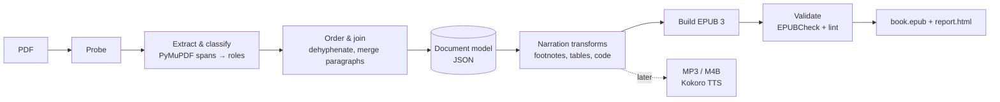

# Earmark

**Turn the PDFs you own into clean, narration-ready EPUB 3 books for text-to-speech apps like ElevenReader. Fully offline.**

> 🚧 **Status: early development.** The design is done and the first milestones are in progress. See the [Roadmap](#roadmap) for what works today.

---

## Why

Text-to-speech apps read PDFs badly. Typeset books are full of things that make sense on a page but sound broken when read aloud:

- page numbers and running titles read in the middle of a sentence ("…the model predicts *four, Chapter 1: Introduction*, the next token…")
- words split by line-break hyphens ("struc- ture")
- paragraphs cut in half at every page break
- footnote markers glued to words ("blue.3")
- tables read cell by cell, and code read character by character

Earmark rebuilds the book from the PDF's own text layer into a clean, reflowable EPUB 3. It's designed to be **listened to**, and it still reads well on screen.

## Features

**Planned for v0.1 (MVP)**

- 📖 **Chapters and table of contents** built from the PDF's bookmarks, with heading detection as a fallback
- 🧹 **Artifact removal**: running headers and footers, page numbers, line-break hyphenation
- 🔗 **Paragraph repair** across line breaks, page breaks and interruptions by figures
- 📝 **Footnotes read inline**, placed after the sentence that cites them, with clear spoken start and end markers
- 📊 **Table summaries** written by a small local LLM, checked against the table's own numbers, with a rule-based fallback
- 🖼️ **Figures and code** kept on screen, with the caption or a short cue read aloud
- 🔤 **Unicode cleanup**: ligatures, odd spaces, and glyphs that TTS engines mispronounce
- 🏷️ **Metadata**: title, author, language, cover
- ✅ **Self-check**: EPUBCheck validation plus a "narration lint" report that flags anything suspicious
- 🖥️ **Desktop app**: drop in a PDF, get an EPUB

**Later**

- 🎧 Offline audiobook export (MP3 per chapter + M4B with chapter marks) using Kokoro TTS
- Two-column layouts, PDFs without bookmarks, scanned PDFs (OCR), math
- Languages other than English

## Principles

- **Offline by default.** Your books never leave your machine. No API keys, no accounts.
- **Rules first, AI where it helps.** Deterministic rules handle the text, so content is never paraphrased. A local LLM is used only for table summaries, and its output is verified.
- **Runs on modest hardware.** Built and tested on a CPU-only desktop (Intel i5, no GPU).
- **Measurable quality.** Every change is tested against a set of PDFs with known correct text.

## How it works



1. **Probe**: reads bookmarks, fonts and page labels, and checks whether the PDF has a text layer or is scanned.
2. **Extract & classify**: gives every line a role (body, heading, running header, footnote, caption, sidebar, code, table) from its font, size and position.
3. **Order & join**: removes page furniture, rejoins hyphenated words and split paragraphs.
4. **Document model**: one JSON tree per book. Each block remembers its source page, so problems can be traced back.
5. **Narration transforms**: moves footnotes inline, summarizes tables, turns code into spoken cues, normalizes text.
6. **Build & validate**: writes one XHTML file per chapter, the nav, metadata and cover, then validates the result and writes a report.

## Tech stack

| Area | Choice |
| --- | --- |
| Language | Python 3.12, managed with [uv](https://github.com/astral-sh/uv) |
| PDF extraction | [PyMuPDF](https://pymupdf.readthedocs.io/) |
| Layout fallback (later) | [Docling](https://github.com/docling-project/docling) |
| Local LLM | [llama.cpp](https://github.com/ggml-org/llama.cpp) via `llama-cpp-python` (any small instruct GGUF model) |
| EPUB writing | Jinja2 templates + `zipfile` |
| Validation | [EPUBCheck](https://github.com/w3c/epubcheck) (requires Java 11+) |
| Desktop UI | PySide6 (Qt) |
| CLI | Typer |
| Audio (later) | [Kokoro-82M](https://huggingface.co/hexgrad/Kokoro-82M) + ffmpeg |

Works on Windows, macOS and Linux.

## Getting started (development)

> Nothing is packaged yet. These steps are for running from source.

```bash
git clone <this-repo-url>
cd earmark
uv sync
```

Planned CLI usage:

```bash
# Inspect a PDF: bookmarks, fonts, text layer, suggested route
uv run earmark probe "my-book.pdf"

# Convert to EPUB (writes my-book.epub and my-book.report.html)
uv run earmark convert "my-book.pdf" --footnotes inline --tables summarize
```

Optional: install Java 11+ to enable EPUBCheck validation. The table-summary model downloads on first use.

## Roadmap

- [ ] **M0**: ElevenReader probe: test which EPUB features get read aloud, skipped or mangled
- [ ] **M1**: Extractor + debug viewer (PDF pages with boxes colored by detected role)
- [ ] **M2**: First listenable EPUB: cleanup, paragraphs, chapters, metadata, EPUBCheck
- [ ] **M3**: Footnotes inline, sidebars, lists, figures, code cues, Unicode cleanup
- [ ] **M4**: Table detection + verified local-LLM summaries
- [ ] **M5**: Narration lint, HTML report, regression tests over the test set
- [ ] **M6**: Desktop app + Windows/macOS builds
- [ ] **M7**: Offline audiobook export (MP3/M4B)
- [ ] **M8**: Hard layouts: no bookmarks, two columns, OCR, math

## Testing

Quality is measured on a small test set:

- **Round-trip books**: public-domain EPUBs (Project Gutenberg, Standard Ebooks) printed to PDF with headers, footers and hyphenation, then converted back and compared against the original text. That gives exact accuracy numbers.
- **Openly licensed PDFs** (e.g. OpenStax textbooks, arXiv papers) for tables, figures, sidebars and two-column layouts.

```bash
uv run pytest
```

Copyrighted PDFs used for local testing live in `testdata/private/`, which is git-ignored. Please don't open pull requests that add copyrighted books or text taken from them.

## Responsible use

Earmark is meant for converting books and documents **you own or have the right to use**, for your own personal listening and reading. Please don't use it to redistribute copyrighted works.

Earmark is an independent project. It is **not affiliated with or endorsed by ElevenLabs**. "ElevenReader" is mentioned only to describe compatibility.

## Contributing

Issues and ideas are welcome, especially PDFs (that you can legally share) that convert badly. Please include the PDF's page numbers and what you heard versus what you expected.

## License

[AGPL-3.0](LICENSE). Earmark builds on PyMuPDF, which is AGPL-licensed, so the project uses the same license.
